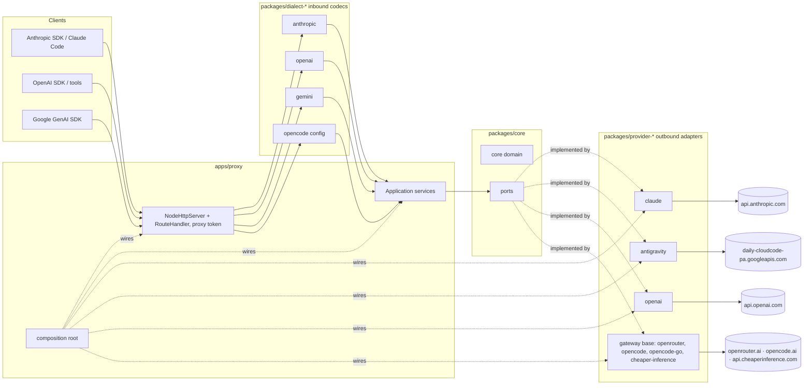

# accounts-proxy

(Renamed on 2026-10-16; [record](docs/reference/2026-10-16-14-40-project-rename.md).) A local LLM proxy. It exposes **Anthropic Messages**, **OpenAI Chat Completions**, **OpenAI Responses** and **Gemini
generateContent** endpoints on `127.0.0.1`, so any stock SDK or tool can call the models of seven providers directly:

| Provider | Sign-in | Upstream | Native formats |
|---|---|---|---|
| **`claude`** | Claude Pro/Max OAuth (browser) | Anthropic Messages | Anthropic Messages |
| **`antigravity`** | Google Antigravity OAuth (browser) | Cloud Code Assist envelope (Gemini, Claude and gpt-oss models) | Gemini |
| **`openai`** | Sign in with ChatGPT, plan usage (browser) | OpenAI Responses | OpenAI Responses |
| **`openrouter`** | OpenRouter PKCE (browser, yields an API key) | OpenRouter API | Chat, Responses and Anthropic Messages for every model |
| **`opencode`** | OpenCode Console device login (browser + code), or a service-account key (`--key`); one account shared with `opencode-go` | `opencode.ai/inference` | per model: Responses (GPT, Grok), Messages (Claude, …), Gemini, Chat |
| **`opencode-go`** | the `opencode` account (Go subscription of the same workspace) | `opencode.ai/inference/go/v1` | per model: Responses, Messages, Chat |
| **`cheaper-inference`** | Cheaper Inference API key (hidden prompt) | `api.cheaperinference.com/v1` | per model: Chat, Responses, Messages (+ `count_tokens`) |

> **Status: P4.6 with amendment A (OpenCode Console), live-validated; detailed model catalog, opencode configuration
> and reference documentation (plan 2026-10-16 C0–C7).** Every provider serves its native formats; a
> request in another format answers 400 `unsupported_feature`: the proxy does not translate between formats (P5
> cancelled 2026-10-14, [plan](docs/plans/2026-10-16-00-08-model-catalog-docs-plan.md)). All seven
> providers were validated live on 2026-10-13 with the official SDKs, Claude Code and opencode, MCP tools included
> ([findings](docs/reference/2026-10-13-02-52-live-validation-findings.md)); P6 on 2026-10-18 measured every native
> cell through the daemon: all pass and stream incrementally ([results](docs/reference/2026-10-18-20-07-p6-live-results.md)). Plans:
> [main](docs/plans/2026-10-06-00-23-inference-router-plan.md), [v4](docs/plans/2026-10-11-22-11-completion-plan.md),
> [P4.6](docs/plans/2026-10-12-15-35-p46-gateway-providers-plan.md),
> [live validation](docs/plans/2026-10-13-01-42-live-validation-plan.md), [P6](docs/plans/2026-10-17-22-59-p6-live-results-plan.md),
> [P7](docs/plans/2026-10-18-22-09-p7-documentation-sweep-plan.md).

> **Terms risk.** The subscription providers' terms restrict third-party clients. The verbatim quotes are in
> [docs/research/2026-10-05-20-07-llm-router-from-auth-plugins.md](docs/research/2026-10-05-20-07-llm-router-from-auth-plugins.md) §3
> and [the OpenAI rules](docs/reference/2026-10-11-23-08-openai-chatgpt-plan-rules.md). `claude`, `antigravity` and
> `openai` stay disabled until their config sets `acknowledgeTermsRisk: true`; the API-key gateways need only
> `enabled: true`.

## Quick start

```sh
bun install
mkdir -p ~/.local/share/accounts-proxy
cp config/proxy.example.yaml ~/.local/share/accounts-proxy/proxy.yaml   # every provider on; remove the ones you do not use
bun run proxy login claude                                                # or any other provider
bun run proxy serve                                                       # 127.0.0.1:4141
bun run proxy token                                                       # the key clients send
```

```ts
import Anthropic from "@anthropic-ai/sdk";
const claude = new Anthropic({ apiKey: TOKEN, baseURL: "http://127.0.0.1:4141/anthropic" });
await claude.messages.create({ model: "claude/claude-haiku-4-5-20251001", max_tokens: 256, messages: [{ role: "user", content: "hi" }] });
```

Models are addressed as `<provider>/<model>` (or an alias from `proxy.yaml`).

## Use it from

| Client | How | Setup |
|---|---|---|
| Anthropic SDK | `baseURL` `…/anthropic`, the token as `apiKey` | [client setup §2](docs/reference/2026-10-17-19-26-client-setup.md#2-sdks-typescript-the-versions-the-tests-pin) |
| OpenAI SDK, Chat Completions and Responses | `baseURL` `…/openai/v1`, the token as `apiKey` | [§2](docs/reference/2026-10-17-19-26-client-setup.md#2-sdks-typescript-the-versions-the-tests-pin) |
| Google Gen AI SDK | `httpOptions.baseUrl` `…/gemini`, the token as `apiKey` | [§2](docs/reference/2026-10-17-19-26-client-setup.md#2-sdks-typescript-the-versions-the-tests-pin) |
| Tools built on these SDKs (OpenAI-compatible and others) | the SDK's own environment variables | [§3](docs/reference/2026-10-17-19-26-client-setup.md#3-from-the-environment-tools-built-on-the-sdks) |
| HTTP (`curl`) | any of the four token carriers | [§4](docs/reference/2026-10-17-19-26-client-setup.md#4-http-directly) |
| Claude Code | `ANTHROPIC_BASE_URL` | [§5](docs/reference/2026-10-17-19-26-client-setup.md#5-claude-code-anthropic-messages) |
| opencode v2 | `opencode auth login http://127.0.0.1:4141` | [§6](docs/reference/2026-10-17-19-26-client-setup.md#6-opencode-v2) |

## Documentation

| Reference | Content |
|---|---|
| [API](docs/reference/2026-10-17-19-26-proxy-api.md) | address and token, `<provider>/<model>`, every route, the proxy headers, every error code and shape, the command line, `proxy.yaml`, the data directory, environment variables, limits and timers |
| [OpenAPI 3.1](docs/reference/2026-10-17-19-26-proxy-openapi.json) | the HTTP API, machine-readable; checked against the real daemon in `verify` |
| [Providers](docs/reference/2026-10-17-19-26-providers.md) | per provider: sign-in, credentials, renewal, native routes and upstream endpoints, answer headers, model list, quota, live findings |
| [Format fields](docs/reference/2026-10-17-19-26-format-fields.md) | per native cell, field by field: what passes, what changes, what is refused, and the rule behind it |
| [Models](docs/reference/2026-10-17-19-26-models.md) | every model of every provider: formats, limits, media, tools, reasoning, price, opencode variants (generated) |
| [Client setup](docs/reference/2026-10-17-19-26-client-setup.md) | the SDKs, HTTP, Claude Code, opencode, and what a refused request means |

`apps/proxy/tests/unit/docs-in-step.test.ts` and `apps/proxy/tests/e2e/docs.test.ts` keep these documents in step with
the code inside `bun run verify`.

## Format × provider matrix

| Inbound format \ Provider | claude | antigravity | openai | openrouter | opencode | opencode-go | cheaper-inference |
|---|---|---|---|---|---|---|---|
| Anthropic Messages | native | — | — | native | native per model | native per model | native per model |
| OpenAI Chat Completions | — | — | — | native | native per model | native per model | native per model |
| OpenAI Responses | — | — | native | native | native per model | native per model | native per model |
| Gemini generateContent | — | near-native | — | — | native per model | — | — |

"Native per model": the models whose list entry names that format ([models](docs/reference/2026-10-17-19-26-models.md)).
"—": 400 `unsupported_feature`.

## Architecture



[docs/architecture.drawio](docs/architecture.drawio) has four pages: the full components, the request flow (each
check and the error it answers), renewal under locks, and the format × provider matrix; `bun run verify` checks it
against the code. The architecture rules are in [AGENTS.md](AGENTS.md).

Workspaces:

| Workspace | Directory | Role |
|---|---|---|
| `@accounts-proxy/core` | `packages/core` | domain and ports |
| `@accounts-proxy/provider-claude` | `packages/provider-claude` | Claude subscription provider |
| `@accounts-proxy/provider-antigravity` | `packages/provider-antigravity` | Antigravity provider |
| `@accounts-proxy/provider-openai` | `packages/provider-openai` | OpenAI provider (Sign in with ChatGPT plan usage) |
| `@accounts-proxy/provider-gateway` | `packages/provider-gateway` | shared base of the API-key gateways (native cells, catalogs, key sessions and logins) |
| `@accounts-proxy/provider-{openrouter,opencode,cheaper-inference}` | `packages/provider-*` | the gateway vendors' rules, logins, catalogs and quota |
| `@accounts-proxy/dialect-{anthropic,openai,gemini}` | `packages/dialect-*` | dialect codecs: proxy errors and model lists |
| `@accounts-proxy/dialect-opencode` | `packages/dialect-opencode` | the opencode v2 configuration and well-known manifest; opencode's variant rules |
| `@accounts-proxy/proxy` | `apps/proxy` | application, adapters, composition, CLI |
| `@accounts-proxy/test-support` | `tests/support` | shared test doubles, guarded temp directories, e2e replay upstreams and process runner |
| `@accounts-proxy/scripts` | `scripts` | release gate and evidence scripts |

Every import of the repository's own code uses the workspace name, `@accounts-proxy/<workspace>/<subpath>.ts`,
also inside one workspace. Relative imports are rejected by the architecture gate.

## Development

| Command | What it does |
|---|---|
| `bun install` | install the pinned toolchain (Bun 1.4.2) |
| `bun run typecheck` | `tsc --noEmit` over every workspace, test and script |
| `bun run test` | unit + component + architecture + support tests |
| `bun run coverage` | same set under istanbul; fails below 100% lines/statements/functions/branches or if a source file is never loaded |
| `bun run test:e2e` | e2e tier: the real entry as child processes under the coverage preload, the official SDKs, replay upstreams; then the e2e-alone coverage gate (100%; the deferral list is empty: [R1](docs/reference/2026-10-11-11-43-p4-e2e-coverage-r1.md)) |
| `bun run test:live` | real-account tier (never part of `verify`) |
| `ACCOUNTS_PROXY_LIVE=1 bun scripts/evidence/live/l1-live-matrix.ts` | the live matrix: every provider's native cells through the daemon with the official SDKs (about 80 small requests; `--only=`, `--scenarios=`) |
| `bun run verify` | the full release gate |
| `bun run fetch:specs` | re-fetch the official wire specs into `docs/reference/specs/` |
| `bun scripts/evidence/gateway-snapshots.ts` | regenerate the gateways' built-in model lists from the committed vendor lists |
| `bun scripts/docs/models-reference.ts [--check]` | regenerate the [model reference](docs/reference/2026-10-17-19-26-models.md) from the proxy itself (`--check`: only compare) |

## Evidence

- [P0-E1/E5: wire specs and default port](docs/reference/2026-10-06-00-32-p0-e1-e5-specs-and-port.md)
- [P0-E6: browser-login mechanisms](docs/reference/2026-10-06-00-32-p0-e6-browser-login-mechanisms.md)
- [P0-LIVE findings](docs/reference/2026-10-10-23-17-p0-live-findings.md) ·
  [E2 captures](docs/reference/2026-10-10-22-57-p0-live-e2-captures.md) ·
  [E3 fidelity matrix](docs/reference/2026-10-10-23-17-fidelity-matrix.md) ·
  [Q6 thinking probe](docs/reference/2026-10-10-23-20-q6-thinking-probe.md)
- [P4 e2e coverage, risk R1 and its resolution](docs/reference/2026-10-11-11-43-p4-e2e-coverage-r1.md) ·
  [P4 live daemon smoke](docs/reference/2026-10-11-11-47-p4-live-daemon-smoke.md)
- [E4 refresh-token rotation](docs/reference/2026-10-11-23-06-e4-refresh-rotation.md) ·
  [OpenAI ChatGPT plan rules](docs/reference/2026-10-11-23-08-openai-chatgpt-plan-rules.md)
- [Gateway provider rules](docs/reference/2026-10-12-15-35-gateway-provider-rules.md) ·
  [P4.6 gateway live probe](docs/reference/2026-10-12-16-09-p46-gateway-live-probe.md)
- [Live validation of all seven providers (L0–L4)](docs/reference/2026-10-13-02-52-live-validation-findings.md)
