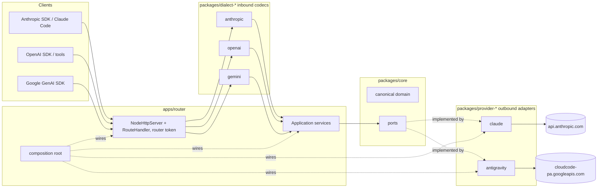

# inference-router

A local LLM router. It exposes **Anthropic Messages**, **OpenAI Chat Completions** and **Gemini generateContent**
endpoints on `127.0.0.1`, so any stock SDK or tool can call the subscription models directly. It routes each call to:

- **`claude`**: Claude Pro/Max OAuth, sent upstream as Anthropic Messages.
- **`antigravity`**: Google Antigravity OAuth, sent upstream through the Cloud Code Assist envelope. It serves Gemini,
  Claude and gpt-oss models.

> **Status: P4.** The daemon serves the two native cells (Anthropic Messages → `claude`, Gemini → `antigravity`) and
> the model lists of all three dialects. The translated cells (OpenAI Chat Completions, Anthropic → antigravity,
> Gemini → claude) arrive in P5 and answer 400 `unsupported_feature` until then. See the plan:
> [docs/plans/2026-10-06-00-23-inference-router-plan.md](docs/plans/2026-10-06-00-23-inference-router-plan.md) and
> [P4](docs/plans/2026-10-10-19-00-p4-daemon-native-cells-plan.md).

> **Terms risk.** Both providers' terms restrict third-party clients. The verbatim quotes are in
> [docs/research/2026-10-05-20-07-llm-router-from-auth-plugins.md](docs/research/2026-10-05-20-07-llm-router-from-auth-plugins.md) §3.
> Each provider stays disabled until its config sets `acknowledgeTermsRisk: true`.

## Configuration

The router keeps everything in its own data directory, `~/.local/share/inference-router/` (override:
`INFERENCE_ROUTER_HOME`). It never reads or writes Claude Code's or the plugins' files.

| Path | Content |
|---|---|
| `router.yaml` | configuration; example: [config/router.example.yaml](config/router.example.yaml). No file = every provider disabled. Unknown keys are errors. |
| `token.json` | the router token clients present (created on first `serve` or `token`, mode 0600) |
| `accounts-<provider>.json` | the router's own accounts and tokens (atomic writes, mode 0600) |
| `state/` | per-install provider state (device and session ids, catalog cache, thought signatures) |
| `locks/` | cross-process lock files (token refresh) |
| `logs/router.log` | the log; never contains tokens |

## Command line

`bun run router <command>` (the workspace also declares the `inference-router` bin):

| Command | What it does |
|---|---|
| `login <provider> [--manual] [--timeout-seconds N]` | Browser sign-in. A loopback listener on `127.0.0.1` captures the redirect (default timeout 300 s). `--manual` is the headless paste-code fallback; only `claude` has one. |
| `account list <provider>` | stored accounts; `*` marks the active one |
| `account use <provider> <account-id>` | choose the active account (the router never switches accounts by itself) |
| `quota <provider>` | remaining quota as reported by the provider (`antigravity`) |
| `models [<provider>]` | each provider's model catalog with advertised limits, and where it came from (live, stored copy, or the built-in list) |
| `serve` | runs the daemon in the foreground on `127.0.0.1:<port>` (Ctrl-C or SIGTERM stops it; in-flight responses get 10 s) |
| `token` | prints the router token (created on first use) |
| `status` | checks whether a daemon answers `GET /health` on the configured port (exit 1 when not) |

Exit codes: 0 success, 1 the command failed, 2 usage error.

## Using the daemon

Start it with `bun run router serve`, then point a stock SDK at it with the router token (`bun run router token`) as
the API key. Models are addressed as `<provider>/<model>` (or an alias from `router.yaml`).

```ts
import Anthropic from "@anthropic-ai/sdk";
const claude = new Anthropic({ apiKey: TOKEN, baseURL: "http://127.0.0.1:4141/anthropic" });
await claude.messages.create({ model: "claude/claude-haiku-4-5-20251001", max_tokens: 256, messages: [{ role: "user", content: "hi" }] });

import { GoogleGenAI } from "@google/genai";
const gemini = new GoogleGenAI({ apiKey: TOKEN, httpOptions: { baseUrl: "http://127.0.0.1:4141/gemini" } });
await gemini.models.generateContent({ model: "antigravity/gemini-3.6-flash-low", contents: "hi" });

import OpenAI from "openai";
const openai = new OpenAI({ apiKey: TOKEN, baseURL: "http://127.0.0.1:4141/openai/v1" });
await openai.models.list(); // chat completions: P5
```

| Route | P4 behaviour |
|---|---|
| `GET /health` | `{status, providers}`; the only route without the token |
| `POST /anthropic/v1/messages`, `POST /anthropic/v1/messages/count_tokens` | `claude/*`: native passthrough, streamed as it arrives; other providers: 400 (P5) |
| `POST /gemini/v1beta/models/{model}:streamGenerateContent` (`?alt=sse` or a JSON array), `:generateContent` | `antigravity/*`: near-native cell; `:countTokens`: 400 (Antigravity has no token count) |
| `POST /openai/v1/chat/completions` | 400 `unsupported_feature` (P5) |
| `GET /anthropic/v1/models`, `GET /openai/v1/models`, `GET /gemini/v1beta/models` | every enabled provider's models in that dialect's shape |

The token is accepted as `Authorization: Bearer`, `x-api-key`, `x-goog-api-key` or `?key=`. Errors use each dialect's
own error shape; upstream errors on the native cells pass through with their status, body and `retry-after`.

Router errors:

| Status | Code | When |
|---|---|---|
| 400 | `invalid_request`, `unsupported_feature` | the request cannot be served as sent |
| 401 | `unauthorized` | missing or wrong router token |
| 401 | `provider_auth_required` | no usable login: no account, an unreadable one, or one whose refresh was rejected (`account list` shows it as `[needs login: …]` until `login <provider>`) |
| 404 | `unknown_model`, `unknown_account`, `not_found` | unknown model address, account or route |
| 413 | `payload_too_large` | request body over the limit |
| 429 | `quota_exhausted` | provider quota, with `retry-after` when known |
| 502 | `upstream_unreachable` | no HTTP answer from the provider (DNS, refused, reset) |
| 503 | `provider_disabled` | the provider is not enabled in `router.yaml` |
| 504 | `upstream_timeout` | the provider sent nothing for the idle timeout |
| 500 | `internal_error` | a router defect (details in the log) |

Sign-in sessions (plan v4 Phase H): an access token is renewed 2 minutes before it expires, once for all concurrent
requests and processes. A renewal never undoes a concurrent `login` or `account use` (every account-file write is a
locked read-change-write), each token call is bounded by 30 s, and a renewal that fails transiently (5xx, timeout,
unreachable) keeps using a token that is still valid, retrying after 30 s. On `claude`, an upstream 401 renews the
token once and resends the request before anything reaches the client.

Router headers:

| Header | Direction | Meaning |
|---|---|---|
| `x-router-lossy: 1` | request | drop (instead of rejecting with 400 `unsupported_feature`) what the target cannot carry |
| `x-router-dropped` | response | every feature or element removed from the request, comma-separated — lossy drops and the always-applied wire laws (unsigned Gemini function calls, empty contents, trailing model turns) |
| `x-router-models-source` | response (model lists) | one `provider=source` pair per provider, e.g. `claude=cache,antigravity=live`; source is `live`, `cache` or `static` |

Notes from the live measurements ([P0-LIVE findings](docs/reference/2026-10-10-23-17-p0-live-findings.md)):

- **claude:** a request without `thinking` is sent without thinking, and `thinking: {type: "disabled"}` is honoured
  (decision Q6). Only `anthropic-beta` names in the model's captured set are forwarded; others are 400. Stop
  sequences also match inside thinking text (L4).
- **antigravity:** `thinkingBudget` must be the catalog's value (it is injected when absent); `maxOutputTokens` may
  not exceed the catalog's. Function-calling modes other than `AUTO`/`VALIDATED` are 400 (the upstream ignores or
  rejects them, L6). Tool schemas may use only `type, format, description, nullable, enum, items, properties,
  required, propertyOrdering`. The model list is the upstream catalog minus its tab/deprecated ids and can include IDE
  helper models such as `tab_*` (L13).
- **Model-list fields the catalogs do not have** are neutral markers, never invented values: Antigravity models list
  `created_at: 1970-01-01T00:00:00Z` (Anthropic shape) and `created: 0` (OpenAI shape); Gemini-shape `version` is the
  provider id and `baseModelId` the routable `<provider>/<model>` (decision Q5).

## Dialect × provider matrix

| Inbound dialect \ Provider | claude | antigravity |
|---|---|---|
| Anthropic Messages | native passthrough (P4) | translated (P5) |
| OpenAI Chat Completions | translated (P5) | translated (P5) |
| Gemini generateContent | translated (P5) | near-native (P4) |

## Architecture



The full component diagram is [docs/architecture.drawio](docs/architecture.drawio). The architecture rules are in
[AGENTS.md](AGENTS.md).

Workspaces:

| Workspace | Directory | Role |
|---|---|---|
| `@inference-router/core` | `packages/core` | canonical domain and ports |
| `@inference-router/provider-claude` | `packages/provider-claude` | Claude subscription provider |
| `@inference-router/provider-antigravity` | `packages/provider-antigravity` | Antigravity provider |
| `@inference-router/dialect-{anthropic,openai,gemini}` | `packages/dialect-*` | dialect codecs: router errors and model lists (P4), translation (P5) |
| `@inference-router/router` | `apps/router` | application, adapters, composition, CLI |
| `@inference-router/test-support` | `tests/support` | shared test doubles, guarded temp directories, e2e replay upstreams and process runner |
| `@inference-router/scripts` | `scripts` | release gate and evidence scripts |

Every import of the repository's own code uses the workspace name, `@inference-router/<workspace>/<subpath>.ts`,
also inside one workspace. Relative imports are rejected by the architecture gate.

## Development

| Command | What it does |
|---|---|
| `bun install` | install the pinned toolchain (Bun 1.4.2) |
| `bun run typecheck` | `tsc --noEmit` over every workspace, test and script |
| `bun run test` | unit + component + architecture + support tests |
| `bun run coverage` | same set under istanbul; fails below 100% lines/statements/functions/branches or if a source file is never loaded |
| `bun run test:e2e` | e2e tier: the real entry as child processes under the coverage preload, the official SDKs, replay upstreams; then the e2e-alone coverage gate (100%, P5-only code deferred by name: [R1](docs/reference/2026-10-11-11-43-p4-e2e-coverage-r1.md)) |
| `bun run test:live` | real-account tier (never part of `verify`) |
| `bun run verify` | the full release gate |
| `bun run fetch:specs` | re-fetch the official wire specs into `docs/reference/specs/` |

## Evidence

- [P0-E1/E5: wire specs and default port](docs/reference/2026-10-06-00-32-p0-e1-e5-specs-and-port.md)
- [P0-E6: browser-login mechanisms](docs/reference/2026-10-06-00-32-p0-e6-browser-login-mechanisms.md)
- [P0-LIVE findings](docs/reference/2026-10-10-23-17-p0-live-findings.md) ·
  [E2 captures](docs/reference/2026-10-10-22-57-p0-live-e2-captures.md) ·
  [E3 fidelity matrix](docs/reference/2026-10-10-23-17-fidelity-matrix.md) ·
  [Q6 thinking probe](docs/reference/2026-10-10-23-20-q6-thinking-probe.md)
- [P4 e2e coverage, risk R1 and its resolution](docs/reference/2026-10-11-11-43-p4-e2e-coverage-r1.md) ·
  [P4 live daemon smoke](docs/reference/2026-10-11-11-47-p4-live-daemon-smoke.md)
