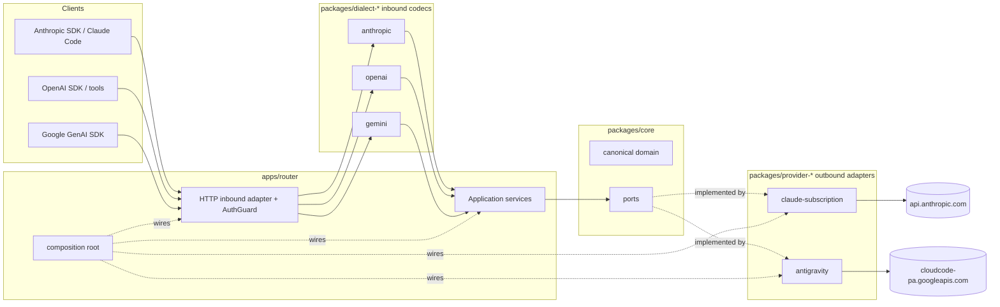

# inference-router

A local LLM router. It exposes **Anthropic Messages**, **OpenAI Chat Completions** and **Gemini generateContent**
endpoints on `127.0.0.1`, so any stock SDK or tool can call the subscription models directly. It routes each call to:

- **`claude-subscription`**: Claude Pro/Max OAuth, sent upstream as Anthropic Messages.
- **`antigravity`**: Google Antigravity OAuth, sent upstream through the Cloud Code Assist envelope. It serves Gemini,
  Claude and gpt-oss models.

> **Status: P3.** Both providers are extracted from their plugins with parity tests. The command line can sign in,
> manage accounts, report quota and list the live models. No HTTP endpoint is served yet (P4). See the plan:
> [docs/plans/2026-10-06-00-23-inference-router-plan.md](docs/plans/2026-10-06-00-23-inference-router-plan.md).

> **Terms risk.** Both providers' terms restrict third-party clients. The verbatim quotes are in
> [docs/research/2026-10-05-20-07-llm-router-from-auth-plugins.md](docs/research/2026-10-05-20-07-llm-router-from-auth-plugins.md) §3.
> Each provider stays disabled until its config sets `acknowledgeTermsRisk: true`.

## Configuration

The router keeps everything in its own data directory, `~/.local/share/inference-router/` (override:
`INFERENCE_ROUTER_HOME`). It never reads or writes Claude Code's or the plugins' files.

| Path | Content |
|---|---|
| `router.yaml` | configuration; example: [config/router.example.yaml](config/router.example.yaml). No file = every provider disabled. Unknown keys are errors. |
| `accounts-<provider>.json` | the router's own accounts and tokens (atomic writes, mode 0600) |
| `state/` | per-install provider state (device and session ids, catalog cache, thought signatures) |
| `locks/` | cross-process lock files (token refresh) |
| `logs/router.log` | the log; never contains tokens |

## Command line

`bun run router <command>` (the workspace also declares the `inference-router` bin):

| Command | What it does |
|---|---|
| `login <provider> [--manual] [--timeout-seconds N]` | Browser sign-in. A loopback listener on `127.0.0.1` captures the redirect (default timeout 300 s). `--manual` is the headless paste-code fallback; only `claude-subscription` has one. |
| `account list <provider>` | stored accounts; `*` marks the active one |
| `account use <provider> <account-id>` | choose the active account (the router never switches accounts by itself) |
| `quota <provider>` | remaining quota as reported by the provider (`antigravity`) |
| `models [<provider>]` | the live model catalog with advertised limits |

Exit codes: 0 success, 1 the command failed, 2 usage error.

## Planned dialect × provider matrix

| Inbound dialect \ Provider | claude-subscription | antigravity |
|---|---|---|
| Anthropic Messages | native passthrough | translated |
| OpenAI Chat Completions | translated | translated |
| Gemini generateContent | translated | near-native |

## Architecture

The full component diagram is [docs/architecture.drawio](docs/architecture.drawio). The architecture rules are in
[AGENTS.md](AGENTS.md).

## Development

| Command | What it does |
|---|---|
| `bun install` | install the pinned toolchain (Bun 1.4.2) |
| `bun run typecheck` | `tsc --noEmit` over every workspace, test and script |
| `bun run test` | unit + component + architecture + support tests |
| `bun run coverage` | same set under istanbul; fails below 100% lines/statements/functions/branches or if a source file is never loaded |
| `bun run test:e2e` | e2e tier with daemon coverage (INCOMPLETE until P4) |
| `bun run test:live` | real-account tier (never part of `verify`) |
| `bun run verify` | the full release gate |
| `bun run fetch:specs` | re-fetch the official wire specs into `docs/reference/specs/` |

## Evidence

- [P0-E1/E5: wire specs and default port](docs/reference/2026-10-06-00-32-p0-e1-e5-specs-and-port.md)
- [P0-E6: browser-login mechanisms](docs/reference/2026-10-06-00-32-p0-e6-browser-login-mechanisms.md)
